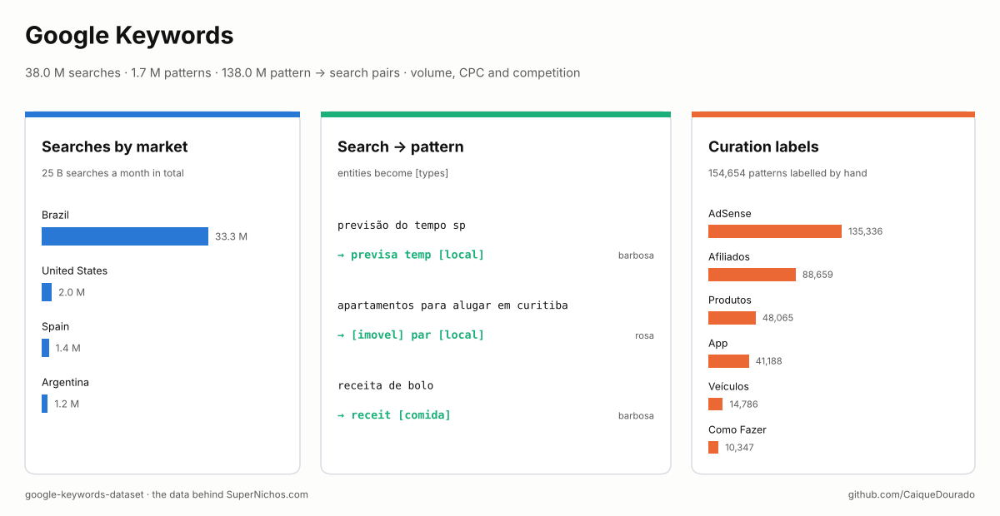
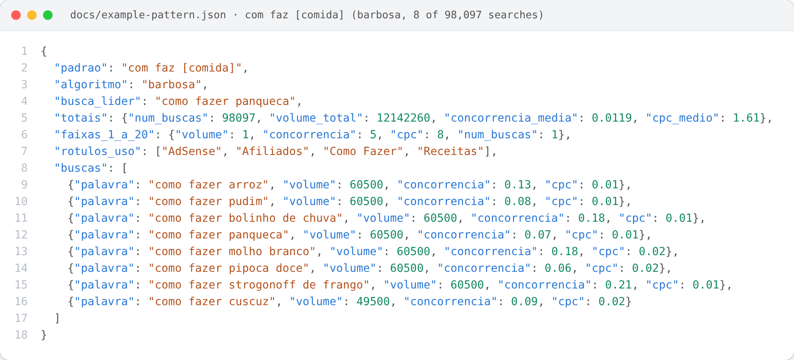
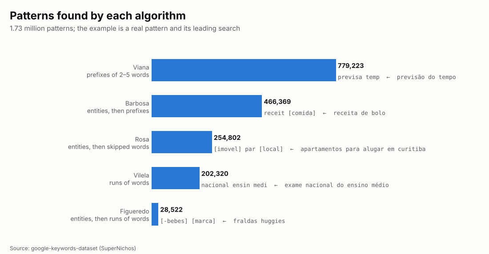
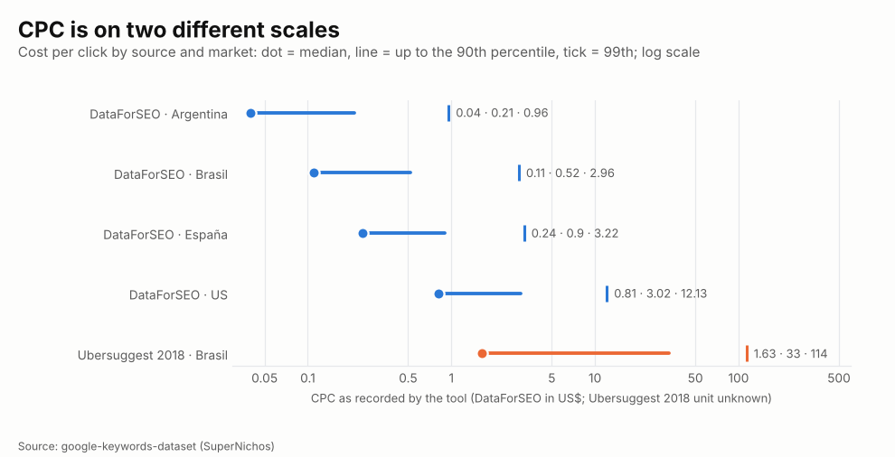
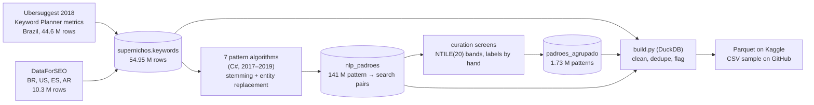

# Google Keywords · Palavras-chave do Google

[](https://github.com/CaiqueDourado/google-keywords-dataset/actions/workflows/validate.yml)
[](LICENSE-DATA.md)
[](LICENSE)
[](https://www.kaggle.com/datasets/caiquedourado/google-keywords-dataset)

[Leia em português](README.pt-BR.md)



A free **Google keyword research dataset**, Brazilian Portuguese first, plus the US, Spain and Argentina:
**37,961,526 search queries** with **monthly search volume, CPC and competition**, grouped into
**1.73 million search patterns** by five pattern-mining algorithms, with **138 million pattern → search pairs** and
**154,654 patterns labelled by hand** with what they were good for (AdSense, affiliates, products, apps…).

It is the data behind **[SuperNichos.com](https://supernichos.com)**, a niche-discovery tool, and behind the
choice of the ~80 programmatic SEO sites the author built from 2017 on. Use it for keyword research, niche
discovery, content planning, query classification, or to study what Brazilians search for.

## What is inside

| Market | Searches | Share | Source | Patterns and labels |
|---|---:|---:|---|---|
| Brazil (BR) | 33,289,393 | 88% | Ubersuggest 2018 + DataForSEO | yes |
| United States (US) | 2,005,560 | 5% | DataForSEO | prefix patterns only |
| Spain (ES) | 1,434,325 | 4% | DataForSEO | prefix patterns only |
| Argentina (AR) | 1,232,248 | 3% | DataForSEO | prefix patterns only |


| File | Rows | What |
|---|---:|---|
| `palavras_chave-*.parquet` | 37,961,526 | one search per row: `palavra`, `mercado` (BR, US, ES, AR), `fonte`, `volume`, `concorrencia` (0–1), `cpc`, `id_padrao`, `num_palavras`, `adulto` |
| `padroes.parquet` | 2,040,760 | the prefix patterns used by SuperNichos (`previsa temp` → *previsão do tempo*): searches, total volume, leading search, examples, 1–20 bands |
| `padroes_algoritmos.parquet` | 1,731,236 | patterns of every algorithm, with entities (`[cidade]`, `[marca]`…), the curation labels (`rotulos_uso`), the generalized parent pattern and the 1–20 bands |
| `padroes_buscas-*.parquet` | 137,974,529 | which searches each pattern groups, per algorithm |
| `perguntas.parquet` | 4,053,470 | Brazilian searches phrased as questions (como, qual, onde, quando, quanto, por que, melhor, vale a pena…) |
| `stats.json` | | totals |

The full data (44 Parquet files, 1.7 GB) is on [Kaggle](https://www.kaggle.com/datasets/caiquedourado/google-keywords-dataset);
[`sample/`](sample) has 10,000 searches, 4,000 prefix patterns and 2,000 algorithm patterns as CSV.

## How a pattern is structured



One pattern from `padroes_algoritmos`, with the searches it groups (joined through `padroes_buscas` and
`palavras_chave`): `com faz [comida]` is *como fazer + a food*, 98,097 searches and 12.1 million searches a month,
labelled for AdSense, affiliates, how-to and recipes. Full file: [docs/example-pattern.json](docs/example-pattern.json)
(15 searches); [scripts/make_json.py](scripts/make_json.py) builds it for any pattern.

## The site this comes from


**[SuperNichos.com](https://supernichos.com)** (2023–) sells access to this data as a niche-mining tool: "+50 million
search terms, +780 thousand unexplored niches, many countries". Its demo table is `padroes.parquet`: the pattern,
the number of searches, the volume, competition and CPC coloured by their 1–20 band, and two example searches.
This dataset opens that table, adds the patterns of the other algorithms and the labels used to choose the author's
own sites.

## What the data shows

### Five ways to turn searches into patterns



A pattern is what many searches have in common. Words are cut to their stem (*previsão* → `previsa`), and
three of the algorithms first replace known entities by their type, so *apartamentos para alugar em curitiba*
and thousands of similar searches become `[imovel] par [local]`. **749,693 patterns** carry at least one entity.

| Algorithm | Pattern | Leading search | Searches | Monthly volume | Labels |
|---|---|---|---:|---:|---|
| Barbosa | `[site] entrar` | facebook entrar | 1,875 | 165,143,090 | AdSense, Entrar em Sites |
| Barbosa | `result [loterias]` | resultado da quina | 19,132 | 16,113,460 | AdSense, Resultado da Loteria |
| Barbosa | `consult [documento]` | consulta cnpj | 5,923 | 12,752,380 | AdSense, Consulta Documento |
| Barbosa | `com faz [comida]` | como fazer panqueca | 98,097 | 12,142,260 | AdSense, Afiliados, Como Fazer, Receitas |
| Barbosa | `[medicamento] par` | remédio para emagrecer | 18,031 | 4,201,150 | Afiliados, Medicamento, Produtos |
| Rosa | `impost [ano]` | imposto de renda 2017 | 18,447 | 976,210 | (not labelled) |
| Viana | `previsa temp` | previsão do tempo | 90,120 | 51,473,610 | AdSense, Previsão do Tempo |

### What each pattern was good for


While choosing niches, the author labelled 154,654 patterns by hand with the way they could make money and the
kind of page they needed. **AdSense** (135,336) and **Afiliados** (affiliate links, 88,659) dominate; the rest is
the type of site: products, apps, vehicles, how-to, prices, quotes, films, weather, places nearby, public exams,
medicines. No public keyword dataset carries this kind of judgement.

### CPC: two scales



The two sources did not record CPC on the same scale. DataForSEO looks like US dollars (median US$ 0.81 in the
US, US$ 0.11 in Brazil). The 2018 Ubersuggest values for Brazil run 15 to 60 times higher and their unit is not
known: compare CPC only within one `fonte`.

## Use it

```python
import duckdb

kw = "palavras_chave-*.parquet"          # on Kaggle: /kaggle/input/google-keywords-dataset/palavras_chave-*.parquet
duckdb.sql(f"""
    SELECT palavra, volume, cpc FROM '{kw}'
    WHERE mercado = 'BR' AND palavra ILIKE '%air fryer%' AND NOT adulto
    ORDER BY volume DESC NULLS LAST LIMIT 20""").show()

# niches labelled for affiliates, biggest first
duckdb.sql("""
    SELECT padrao, busca_lider, num_buscas, volume_total, rotulos_uso FROM 'padroes_algoritmos.parquet'
    WHERE rotulos_uso LIKE '%Afiliados%' AND NOT adulto
    ORDER BY volume_total DESC LIMIT 20""").show()
```

The [notebook](notebooks/estudo.ipynb) has more queries.

## How it was made



- **Sources.** Batch 1 (44.6 million rows, Brazil only) came from Ubersuggest in 2018, which served Google
  Keyword Planner metrics; batch 2 (10.3 million rows, four markets) from DataForSEO. Column `fonte` says which.
  Metrics are a snapshot of when they were collected, not current numbers.
- **Markets.** The original `idioma` column was the market of the tool: `pt-br` → BR, `en` → US, `es` → ES,
  `ar` → AR (Argentina, Spanish).
- **Cleaning** ([scripts/build.py](scripts/build.py)): a zero volume became empty (in batch 1, 0 meant "no metric":
  only 5,330 of 18.3 million zeros had competition or CPC); competition on a 0–100 scale divided by 100; apostrophes
  doubled on import fixed; 9,220 searches damaged into `??` removed; duplicates (same market, same search ignoring
  case and spaces) collapsed from 54.95 million rows to 37.96 million, keeping the row with volume.
- **Patterns.** Words are stemmed and patterns have 2–5 words. Viana takes prefixes, Vilela runs of words; Barbosa,
  Figueredo and Rosa do the same after replacing entities with a dictionary of ~316 thousand entities (places, people, brands, products, foods…). Oliveira (skip-grams)
  and Dourado (word permutations) were used in earlier rounds and are not in the grouped table.
- **Adult searches** (39,496) are kept and flagged in `adulto`, so they can be filtered out; the samples have none.
- **Exports** ([scripts/exportar_supernichos.py](scripts/exportar_supernichos.py)) read each SQL Server table once,
  in sequence, into Parquet; every check runs on the Parquet with DuckDB
  ([scripts/conferir_buscas.py](scripts/conferir_buscas.py)).

## Limits

- Volumes, CPC and competition are from 2018 (Ubersuggest) and from the DataForSEO collection; they are not updated.
- CPC is not comparable between sources (see the chart).
- Brand names in searches are kept as people typed them; they are searches, not endorsements.
- Patterns use stems, so they read oddly (`receit [comida]`); `busca_lider` shows a real search for each.
- The entity dictionary has mistakes of its own (`[inseto]` for *aéreas*), visible in some patterns.

## Related

- [DedupKit](https://github.com/CaiqueDourado/DedupKit): phonetic keys and matching for Portuguese, the same family of techniques used to group searches.
- [PtBr.Text](https://github.com/CaiqueDourado/PtBr.Text): Portuguese text tools for .NET, including RAKE keyword extraction.
- [catalogo-produtos-ecommerce-brasil](https://github.com/CaiqueDourado/catalogo-produtos-ecommerce-brasil): the products many of these searches are about.

## License

The compilation, the patterns, the labels and the derived columns are [CC BY 4.0](LICENSE-DATA.md); the metrics come
from third-party tools (see the license file). Code: [MIT](LICENSE). Removal requests: open an issue.

## Author

**Caique Dourado**: 20 years building crawlers, data pipelines and programmatic SEO in .NET and SQL Server. More at [github.com/CaiqueDourado](https://github.com/CaiqueDourado).
