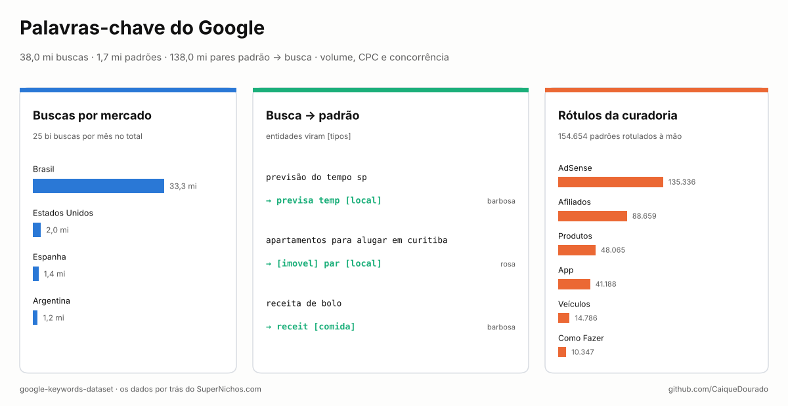
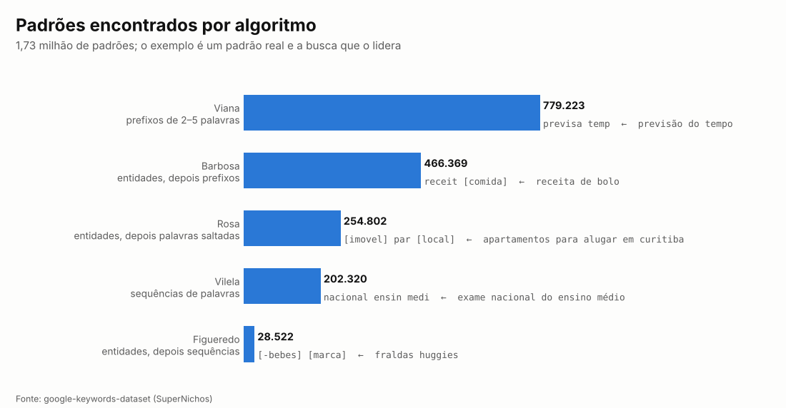
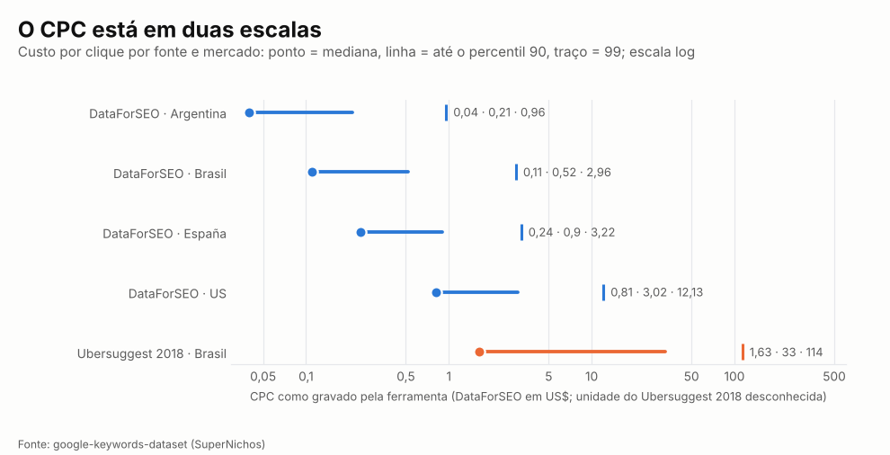
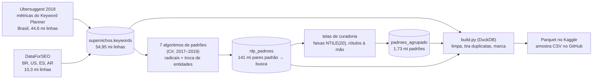

# Palavras-chave do Google

[](https://github.com/CaiqueDourado/google-keywords-dataset/actions/workflows/validate.yml)
[](LICENSE-DATA.md)
[](LICENSE)
[](https://www.kaggle.com/datasets/caiquedourado/google-keywords-dataset)
[](https://www.kaggle.com/code/caiquedourado/notebook-google-keywords-dataset)

[Read in English](README.md)



Uma **base gratuita de pesquisa de palavras-chave do Google**, com o Brasil em primeiro lugar e também EUA,
Espanha e Argentina: **37.961.526 buscas** com **volume mensal, CPC e concorrência**, agrupadas em
**1,73 milhão de padrões de busca** por cinco algoritmos de mineração de padrões, com **138 milhões de pares
padrão → busca** e **154.654 padrões rotulados à mão** com a utilidade de cada um (AdSense, afiliados, produtos,
apps…).

São os dados por trás do **[SuperNichos.com](https://supernichos.com)**, uma ferramenta de descoberta de nichos,
e da escolha dos ~80 sites de SEO programático que o autor construiu a partir de 2017. Servem para pesquisa de
palavras-chave, descoberta de nichos, pauta de conteúdo, classificação de buscas ou para estudar o que o
brasileiro procura.

## O que tem

| Mercado | Buscas | Parte | Fonte | Padrões e rótulos |
|---|---:|---:|---|---|
| Brasil (BR) | 33.289.393 | 88% | Ubersuggest 2018 + DataForSEO | sim |
| Estados Unidos (US) | 2.005.560 | 5% | DataForSEO | só padrões por prefixo |
| Espanha (ES) | 1.434.325 | 4% | DataForSEO | só padrões por prefixo |
| Argentina (AR) | 1.232.248 | 3% | DataForSEO | só padrões por prefixo |


| Arquivo | Linhas | O que tem |
|---|---:|---|
| `palavras_chave-*.parquet` | 37.961.526 | uma busca por linha: `palavra`, `mercado` (BR, US, ES, AR), `fonte`, `volume`, `concorrencia` (0–1), `cpc`, `id_padrao`, `num_palavras`, `adulto` |
| `padroes.parquet` | 2.040.760 | os padrões por prefixo usados pelo SuperNichos (`previsa temp` → *previsão do tempo*): buscas, volume total, busca líder, exemplos, faixas de 1 a 20 |
| `padroes_algoritmos.parquet` | 1.731.236 | padrões de todos os algoritmos, com entidades (`[cidade]`, `[marca]`…), os rótulos da curadoria (`rotulos_uso`), o padrão pai generalizado e as faixas de 1 a 20 |
| `padroes_buscas-*.parquet` | 137.974.529 | quais buscas cada padrão agrupa, por algoritmo |
| `perguntas.parquet` | 4.053.470 | buscas do Brasil em forma de pergunta (como, qual, onde, quando, quanto, por que, melhor, vale a pena…) |
| `stats.json` | | totais |

Os dados completos (44 arquivos Parquet, 1,7 GB) estão no [Kaggle](https://www.kaggle.com/datasets/caiquedourado/google-keywords-dataset);
[`sample/`](sample) tem 10.000 buscas, 4.000 padrões por prefixo e 2.000 padrões por algoritmo em CSV.

## Como um padrão é estruturado


Um padrão de `padroes_algoritmos`, com as buscas que ele agrupa (ligadas por `padroes_buscas` e `palavras_chave`):
`com faz [comida]` é *como fazer + uma comida*, 98.097 buscas e 12,1 milhões de buscas por mês, rotulado para AdSense,
afiliados, como fazer e receitas. Arquivo completo: [docs/example-pattern.json](docs/example-pattern.json)
(15 buscas); [scripts/make_json.py](scripts/make_json.py) gera o mesmo para qualquer padrão.

## O site de onde isto vem


O **[SuperNichos.com](https://supernichos.com)** (2023–) vende acesso a estes dados como ferramenta de mineração de
nichos: "+50 milhões de termos de pesquisa, +780 mil nichos inexplorados, muitos países". A tabela da demonstração é
o `padroes.parquet`: o padrão, o número de buscas, volume, concorrência e CPC coloridos pela faixa de 1 a 20, e duas
buscas de exemplo. Este dataset abre essa tabela e acrescenta os padrões dos outros algoritmos e os rótulos usados
para escolher os sites do próprio autor.

## O que os dados mostram

### Cinco jeitos de transformar buscas em padrões



Um padrão é o que muitas buscas têm em comum. As palavras são reduzidas ao radical (*previsão* → `previsa`), e três
dos algoritmos antes trocam as entidades conhecidas pelo seu tipo: *apartamentos para alugar em curitiba* e milhares
de buscas parecidas viram `[imovel] par [local]`. **749.693 padrões** têm pelo menos uma entidade.

| Algoritmo | Padrão | Busca líder | Buscas | Volume mensal | Rótulos |
|---|---|---|---:|---:|---|
| Barbosa | `[site] entrar` | facebook entrar | 1.875 | 165.143.090 | AdSense, Entrar em Sites |
| Barbosa | `result [loterias]` | resultado da quina | 19.132 | 16.113.460 | AdSense, Resultado da Loteria |
| Barbosa | `consult [documento]` | consulta cnpj | 5.923 | 12.752.380 | AdSense, Consulta Documento |
| Barbosa | `com faz [comida]` | como fazer panqueca | 98.097 | 12.142.260 | AdSense, Afiliados, Como Fazer, Receitas |
| Barbosa | `[medicamento] par` | remédio para emagrecer | 18.031 | 4.201.150 | Afiliados, Medicamento, Produtos |
| Rosa | `impost [ano]` | imposto de renda 2017 | 18.447 | 976.210 | (sem rótulo) |
| Viana | `previsa temp` | previsão do tempo | 90.120 | 51.473.610 | AdSense, Previsão do Tempo |

### Para que servia cada padrão


Na escolha de nichos, o autor rotulou à mão 154.654 padrões com o jeito de ganhar dinheiro e o tipo de página que
cada um pedia. **AdSense** (135.336) e **Afiliados** (88.659) dominam; o resto é o tipo de site: produtos, apps,
veículos, como fazer, preços, frases, filmes, previsão do tempo, locais próximos, concursos, medicamentos. Nenhuma
base pública de palavras-chave traz esse tipo de julgamento.

### CPC: duas escalas



As duas fontes não gravaram o CPC na mesma escala. O da DataForSEO parece estar em dólar (mediana de US$ 0,81 nos
EUA e US$ 0,11 no Brasil). Os valores do Ubersuggest 2018 para o Brasil são de 15 a 60 vezes maiores e a unidade não
é conhecida: compare CPC só dentro da mesma `fonte`.

## Como usar

```python
import duckdb

kw = "palavras_chave-*.parquet"          # no Kaggle: /kaggle/input/google-keywords-dataset/palavras_chave-*.parquet
duckdb.sql(f"""
    SELECT palavra, volume, cpc FROM '{kw}'
    WHERE mercado = 'BR' AND palavra ILIKE '%air fryer%' AND NOT adulto
    ORDER BY volume DESC NULLS LAST LIMIT 20""").show()

# nichos rotulados para afiliados, dos maiores para os menores
duckdb.sql("""
    SELECT padrao, busca_lider, num_buscas, volume_total, rotulos_uso FROM 'padroes_algoritmos.parquet'
    WHERE rotulos_uso LIKE '%Afiliados%' AND NOT adulto
    ORDER BY volume_total DESC LIMIT 20""").show()
```

O [notebook](notebooks/estudo.ipynb) tem mais consultas.

## Como foi feito



- **Fontes.** O lote 1 (44,6 milhões de linhas, só Brasil) veio do Ubersuggest em 2018, que mostrava as métricas do
  Google Keyword Planner; o lote 2 (10,3 milhões de linhas, quatro mercados) veio da DataForSEO. A coluna `fonte` diz
  qual. As métricas são uma foto da época da coleta, não números atuais.
- **Mercados.** A coluna original `idioma` era o mercado da ferramenta: `pt-br` → BR, `en` → US, `es` → ES,
  `ar` → AR (Argentina, espanhol).
- **Limpeza** ([scripts/build.py](scripts/build.py)): volume zero virou vazio (no lote 1, 0 queria dizer "sem métrica":
  só 5.330 dos 18,3 milhões de zeros tinham concorrência ou CPC); concorrência na escala 0–100 dividida por 100;
  apóstrofos duplicados na importação corrigidos; 9.220 buscas que viraram `??` removidas; duplicatas (mesmo
  mercado, mesma busca ignorando maiúsculas e espaços) juntadas, de 54,95 milhões de linhas para 37,96 milhões,
  ficando a linha com volume.
- **Padrões.** As palavras são reduzidas ao radical e os padrões têm de 2 a 5 palavras. Viana pega prefixos, Vilela
  sequências de palavras; Barbosa, Figueredo e Rosa fazem o mesmo depois de trocar as entidades por um dicionário de
  ~316 mil entidades (lugares, pessoas, marcas, produtos, comidas…), publicado limpo como
  [portuguese-entity-gazetteer](https://github.com/CaiqueDourado/portuguese-entity-gazetteer). Oliveira (palavras saltadas) e Dourado
  (permutações) foram usados em rodadas anteriores e não estão na tabela agrupada.
- **Buscas adultas** (39.496) ficam, marcadas em `adulto`, para quem quiser filtrar; as amostras não têm nenhuma.
- **Exportação** ([scripts/exportar_supernichos.py](scripts/exportar_supernichos.py)): cada tabela do SQL Server é lida
  uma vez, em sequência, para Parquet; todas as conferências rodam no Parquet com DuckDB
  ([scripts/conferir_buscas.py](scripts/conferir_buscas.py)).

## Limites

- Volume, CPC e concorrência são de 2018 (Ubersuggest) e da coleta da DataForSEO; não são atualizados.
- O CPC não se compara entre as fontes (veja o gráfico).
- Nomes de marca nas buscas ficam como as pessoas digitaram; são buscas, não endosso.
- Os padrões usam radicais e soam estranhos (`receit [comida]`); `busca_lider` mostra uma busca real de cada um.
- O dicionário de entidades tem erros próprios (`[inseto]` para *aéreas*), visíveis em alguns padrões.

## Relacionados

- Artigo: [Quase 400 milhões de padrões de busca, cinco bancos de dados e o que de fato funcionou](https://github.com/CaiqueDourado/articles/blob/main/scale-search-patterns/README.pt-BR.md): como este dataset foi feito em 2018 e refeito em 2026 ([em inglês no Medium](https://medium.com/@caiquedourado/almost-400-million-search-patterns-five-databases-and-what-actually-worked-139cb4a28c4e)).
- Artigo: [Sete jeitos de transformar milhões de buscas do Google em modelos de página](https://github.com/CaiqueDourado/articles/blob/main/seven-ways-search-patterns/README.pt-BR.md): os algoritmos que fizeram os padrões deste dataset ([em inglês no Medium](https://medium.com/@caiquedourado/seven-ways-to-turn-millions-of-google-searches-into-page-templates-3671235eac0f)).
- [portuguese-entity-gazetteer](https://github.com/CaiqueDourado/portuguese-entity-gazetteer): o dicionário de entidades por trás dos padrões com `[tipo]`, limpo: 307 mil entidades com seus tipos ([Kaggle](https://www.kaggle.com/datasets/caiquedourado/portuguese-entity-gazetteer)).
- [search-pattern-miner](https://github.com/CaiqueDourado/search-pattern-miner): os sete algoritmos de padrões como biblioteca (Python e .NET), com um modo 2019 que reproduz os padrões deste dataset.
- [DedupKit](https://github.com/CaiqueDourado/DedupKit): chaves fonéticas e casamento de nomes em português, a mesma família de técnicas usada para agrupar buscas.
- [PtBr.Text](https://github.com/CaiqueDourado/PtBr.Text): ferramentas de texto em português para .NET, com extração de palavras-chave RAKE.
- [brazilian-ecommerce-products](https://github.com/CaiqueDourado/brazilian-ecommerce-products): os produtos de que muitas dessas buscas falam.
- [dicionario-portugues](https://github.com/CaiqueDourado/dicionario-portugues): 272 mil palavras do português com chaves fonéticas, rimas e textos gerados por IA ([Kaggle](https://www.kaggle.com/datasets/caiquedourado/dicionario-portugues)); a coluna `ocorrencias` conta estas buscas.

## Licença

A compilação, os padrões, os rótulos e as colunas derivadas são [CC BY 4.0](LICENSE-DATA.md); as métricas vêm de
ferramentas de terceiros (veja o arquivo de licença). Código: [MIT](LICENSE). Pedidos de remoção: abra uma issue.

## Autor

**Caique Dourado**: 20 anos construindo crawlers, pipelines de dados e SEO programático em .NET e SQL Server. Mais em [github.com/CaiqueDourado](https://github.com/CaiqueDourado).
